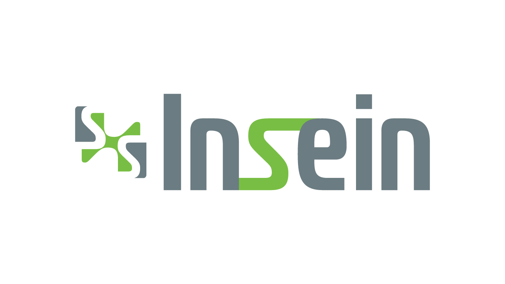

# INSEIN SRL — Sitio Web Corporativo



> **Ingeniería en Seguridad Eléctrica y Control de Incendios**  
> Tarija, Bolivia — Cobertura Nacional e Internacional

🌐 **Live:** [carlosqe.github.io/insein-web](https://carlosqe.github.io/insein-web/)

---

## 📋 Descripción

Sitio web corporativo de **INSEIN SRL**, empresa boliviana especializada en seguridad eléctrica industrial y protección contra incendios. El nombre INSEIN proviene de **IN**geniería en **SE**guridad Eléctrica e **IN**cendios.

**Servicios principales:**
- Seguridad Eléctrica (NFPA 70E, LOTO, análisis de arco eléctrico)
- Protección Contra Incendios (NFPA 1, brigadas, planes de contingencia)
- Salud Ocupacional y Fisioterapia Ocupacional
- Capacitación Técnica especializada

**Sede:** Tarija, Bolivia | **Cobertura:** Nacional e Internacional

---

## 🛠️ Stack Tecnológico

| Capa | Tecnología |
|------|-----------|
| Estructura | HTML5 semántico |
| Estilos | CSS3 con variables nativas (sin framework) |
| Interactividad | Vanilla JS ES6+ (sin dependencias) |
| Internacionalización | i18n propio — Español / Inglés |
| Formulario de contacto | EmailJS + hCaptcha |
| Hosting | GitHub Pages |

---

## 🎨 Sistema de Diseño

### Paleta Oficial
```css
--green:       #78be44;   /* Verde INSEIN — acento principal */
--steel:       #6b7c82;   /* Gris acero — color corporativo */
--white:       #fefefe;   /* Blanco — textos claros */
--dark:        #0d0f12;   /* Negro industrial — fondo */
--surface:     #131820;   /* Superficie — cards y paneles */
```

### Tipografía
- **Display:** Barlow Condensed — headings y títulos de impacto
- **Body:** DM Sans — cuerpo de texto, legible y moderno
- **Nota:** La tipografía corporativa oficial es Magistral Extra Cond (CatFonts, licencia comercial). Barlow Condensed es la aproximación web más cercana disponible en Google Fonts.

---

## 📁 Estructura del Proyecto

```
insein-web/
├── index.html                   ← Página principal (única)
├── CNAME                        ← Dominio personalizado (GitHub Pages)
├── assets/
│   ├── css/
│   │   ├── styles.css           ← Variables globales, base, navbar, hero, footer
│   │   ├── sprint2.css          ← Ticker, galería lightbox, cards premium
│   │   ├── sprint3.css          ← Certificaciones acordeón, timeline
│   │   ├── sprint4.css          ← Formulario de contacto, sección why
│   │   └── sprint5.css          ← Partners/alianzas, blog/recursos, hCaptcha
│   ├── js/
│   │   ├── i18n.js              ← Traducciones ES / EN
│   │   ├── main.js              ← Animaciones, scroll, cursor, tabs
│   │   ├── contact.js           ← EmailJS + hCaptcha + rate limiting
│   │   ├── sprint2.js           ← Lightbox galería
│   │   └── sprint3.js           ← Acordeón certificaciones, contadores
│   └── img/
│       ├── logo-imagotipo.png   ← Logo completo (navbar, footer, og)
│       └── logo-isotipo.png     ← Isotipo (favicon)
└── README.md
```

---

## 🗂️ Secciones del Sitio

| Sección | ID | Descripción |
|---------|----|-------------|
| Hero | `#hero` | Título principal, slogan, CTAs, stats animadas |
| Ticker | — | Franja animada con servicios y alianzas |
| Servicios | `#servicios` | 3 pestañas: Emergencias · Técnica · Salud |
| ¿Por qué INSEIN? | `#por-que` | Diferenciadores y métricas clave |
| Timeline | — | Historia corporativa 2024–2026 |
| Alianzas | `#socios` | 6 socios estratégicos nacionales e internacionales |
| Galería | `#galeria` | Portfolio visual con lightbox |
| Certificaciones | `#certificaciones` | Acordeón de certificaciones NFPA / IBNORCA |
| Recursos | `#blog` | NFPA.org · IEEE.org · Portal interno SharePoint |
| Contacto | `#contacto` | Formulario EmailJS + hCaptcha |

---

## ⚙️ Instalación Local

```bash
# 1. Clonar el repositorio
git clone https://github.com/CarlosQE/insein-web.git
cd insein-web

# 2. Abrir con Live Server (VS Code) o directo en navegador
# No requiere servidor ni dependencias npm
```

**Extensiones VS Code recomendadas:** Live Server · Prettier · HTML CSS Support

---

## 📧 Configuración EmailJS

El formulario usa [EmailJS](https://emailjs.com) con Outlook / Microsoft 365.

**Variables en `assets/js/contact.js`:**
```javascript
const EMAILJS_CONFIG = {
  publicKey:  'tu_public_key',    // Account → General → Public Key
  serviceId:  'service_xxxxxxx',  // Email Services → nombre del servicio
  templateId: 'template_xxxxxxx', // Email Templates → nombre de la plantilla
  demoMode:   false,              // true = simula envío sin credenciales
  toEmail:    'info@inseinsrl.com',
};
```

**Variables de la plantilla EmailJS:**
`{{from_name}}` · `{{company}}` · `{{from_email}}` · `{{phone}}` · `{{service}}` · `{{message}}`

**Seguridad adicional:** En el dashboard de EmailJS → Email Services → Settings → **Allowed Origins** agregar el dominio de producción para que la Public Key solo funcione desde el sitio oficial.

---

## 🛡️ Seguridad

| Medida | Implementación |
|--------|---------------|
| Anti-spam formulario | hCaptcha (tema oscuro, sitekey configurado) |
| Rate limiting | Máx. 3 envíos/hora por sesión (sessionStorage) |
| Links externos | `rel="noopener noreferrer"` en todos los `target="_blank"` |
| EmailJS origin | Allowed Origins restringido al dominio de producción |
| Datos sensibles | No hay backend secrets en el frontend — Public Key de EmailJS es de uso público por diseño |

---

## 🌐 Deploy y Dominio

El sitio se despliega automáticamente desde la rama `main` vía GitHub Pages.

```bash
# Deploy automático al hacer push
git add .
git commit -m "descripción del cambio"
git push origin main
```

**Para dominio personalizado (`www.inseinsrl.com`):**

1. En el registrador de dominio, agregar registros DNS:

| Tipo | Nombre | Valor |
|------|--------|-------|
| A | `@` | `185.199.108.153` |
| A | `@` | `185.199.109.153` |
| A | `@` | `185.199.110.153` |
| A | `@` | `185.199.111.153` |
| CNAME | `www` | `carlosqe.github.io` |

2. En GitHub → Settings → Pages → Custom domain: `www.inseinsrl.com`
3. Activar **Enforce HTTPS**

---

## 🌍 Internacionalización (i18n)

El sitio soporta **Español** e **Inglés** sin librerías externas. Todas las claves están centralizadas en `assets/js/i18n.js`.

```javascript
// Estructura del objeto de traducciones
const translations = {
  es: { hero_title_1: 'Ingeniería en', ... },
  en: { hero_title_1: 'Engineering in', ... }
};
```

El idioma se guarda en `localStorage` y persiste entre visitas.

---

## 📞 Contacto

**INSEIN SRL**  
📍 Tarija, Bolivia  
📧 info@inseinsrl.com  
💬 WhatsApp: +591 72987377  
🌐 [carlosqe.github.io/insein-web](https://carlosqe.github.io/insein-web/)

---

*© 2026 INSEIN SRL — Todos los derechos reservados.*
